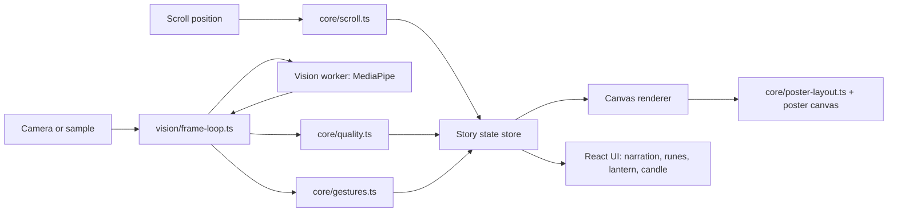

# Design Document

## Overview

Story Scroll Horror is a Next.js (App Router, TypeScript strict) site. One fixed full-screen canvas shows the visitor, cut out of the webcam feed, over a spooky Scene. A tall scroll area drives 6 Chapters. All vision work runs in the browser. Nothing leaves the device (requirement 2).

Design goals, in order: privacy, works without a camera, stays smooth on a mid-range phone, spooky design that does real work (requirements 22 to 24), ships on time.

## Architecture



Layers:

1. **core/** pure TypeScript, no DOM, no MediaPipe. Fully testable in Node (requirement 20.6).
2. **vision/** browser only. Wraps MediaPipe Tasks Vision, owns the frame loop and the worker.
3. **components/** client components. Canvas stage, narration panel, in-world controls, poster dialog.
4. **content/chapters.ts** typed chapter data.
5. **styles/tokens.css** design tokens (palette, focus ring, spacing). No hex values elsewhere.

### Rendering and threading

- The main thread owns the visible canvas and React. The frame loop runs at a throttled rate (target 24 fps render, inference 15 to 30 fps, adaptive) and is independent from scroll events.
- Inference runs in a Web Worker if the spike (Task 1) shows the main thread drops below target with inference on it. Otherwise it runs in a throttled `requestVideoFrameCallback` loop on the main thread. The decision is recorded in this file after the spike.
- MediaPipe is loaded only through dynamic import in `vision/` (requirement 19.4). Model and WASM files are served from `public/models/` and `public/wasm/` (requirement 2.4).
- The loop pauses on `document.visibilitychange` hidden and stops all camera tracks on `pagehide` and on stop (requirements 1.7, 5.3).
- Adaptive quality: a rolling frame time average. Below 20 fps for 3 s, step down one level: lower segmentation frequency, lower input resolution, fewer particles (requirement 5.2). Levels are named constants in `src/vision/perf-config.ts`.

### Which MediaPipe tasks run together (open question 5)

Default plan, to be confirmed by the spike:

| Task | Needed from stage | Rate |
| --- | --- | --- |
| Image Segmenter (selfie, category mask) | 1 | every frame, or every 2nd frame at lower quality levels |
| Face Landmarker (478 points, blendshapes for blink) | 2 for hat and mask anchors, 3 for blink | every 2nd frame |
| Pose Landmarker (lite) | 2 for cape and collar anchors | every 3rd frame |
| Hand Landmarker | 3 | every 2nd frame, only while gestures are on and the active Chapter has a hand event |

Fallback plan if the phone cannot run all tasks: use only the segmenter plus face landmarker, derive shoulder anchors from face position and scale, and run hand landmarks only in Chapters with a lantern event. Record the final choice after the spike.

### Camera and fallback

`vision/camera.ts` exposes `startCamera(facingMode)`, `stopCamera()`, `listCameras()`. Any failure (denied, no device, in use, unsupported, insecure origin) moves the state machine to `fallback` with a reason string. In fallback, a bundled sample video or still plus precomputed landmarks and mask feed the same pipeline (requirements 1.4, 8.7). The pipeline cannot tell the difference between source types.

State machine (core/camera-state.ts, pure): `idle -> asking -> live`, any state `-> fallback(reason)`, `fallback -> asking` on "Try camera again".

## Components and Interfaces

### core/scroll.ts (requirement 4)

```ts
export const CHAPTER_COUNT = 6;
export function clampProgress(p: number): number;            // NaN -> 0, clamp to [0,1]
export function chapterIndex(progress: number): number;      // i/6 <= p < (i+1)/6, p = 1 -> 5
export function chaptersRemaining(index: number): number;    // 6 - index, for the candle
```

### core/gestures.ts (requirements 11, 12)

A pure reducer. Time comes from frame timestamps, not frame counts.

```ts
export type GestureKind = 'raiseHand' | 'blink';
export interface GestureFrame { t: number; handRaisedMargin: number | null; eyeAspectRatio: number | null; }
export interface GestureState { /* per kind: onsetAt, held, lastFiredAt, eyeClosedSince */ }
export interface GestureEvent { kind: GestureKind; at: number; }
export function initialGestureState(): GestureState;
export function stepGestures(state: GestureState, frame: GestureFrame, cfg: GestureConfig): { state: GestureState; events: GestureEvent[] };
export function resetForChapter(state: GestureState): GestureState;
```

`src/core/gesture-config.ts` holds named constants: `RAISE_MARGIN`, `RAISE_HOLD_MS = 300`, `EAR_BLINK_THRESHOLD`, `BLINK_MIN_MS = 60`, `BLINK_MAX_MS = 400`, `COOLDOWN_MS = 1000`.

Rules: raise fires once after `RAISE_HOLD_MS` of continuous hold, then not again until released. Blink fires on eye reopen if closed duration is within `[BLINK_MIN_MS, BLINK_MAX_MS]`. A null input (no hand or face) clears onsets and fires nothing (11.7). Cooldown applies per kind (12.2). Chapter change resets held state (12.3).

### core/story-events.ts (requirements 11.2, 11.4, 12.4, 25)

Maps `GestureEvent` or a fallback button press to a story event (`lightLantern`, `scareGhost`) when the active Chapter defines it and it was not completed. Also owns the session counters (`ghostsScared`, `lanternsLit`, `costumesWorn` as a set of Chapter indexes). Both gesture and button paths call the same function, so the effects are identical (13.2).

### core/quality.ts (requirement 22)

```ts
export interface QualityInput { maskConfidence: number; personCoverage: number; brightness: number; }
export function trackingQuality(i: QualityInput): number;       // always in [0,1], NaN safe
export function smoothQuality(prev: number, next: number, dtMs: number): number;
export function atmosphereFor(q: number): { fogDensity: number; vignetteRadius: number };
export function hintFor(i: QualityInput): 'dark' | 'too-far' | 'off-centre' | 'bright-back' | null;
```

Brightness comes from a mean luma sample of a 32 by 32 downscale of the frame, computed in `vision/` and passed in as a number. Mask confidence is the mean of mask pixels inside the person region. Fog density rises and vignette radius falls as quality drops. The text hint appears after `QUALITY_LOW_MS = 2000` below `QUALITY_LOW`.

### core/poster-layout.ts (requirement 15, 25)

```ts
export const POSTER = { width: 1080, height: 1620, margin: 48 } as const;
export interface TextBlockSpec { text: string; font: FontSpec; maxLines: number; minSize: number; maxSize: number; }
export interface MeasureFn { (text: string, sizePx: number, font: string): number; }
export function layoutPoster(input: PosterInput, measure: MeasureFn): PosterLayout; // all boxes inside margins
export function limitName(raw: string): string;   // trims, caps at 24 chars, default name when empty
export function creditsLine(counts: SessionCounts): string;
```

The measure function is injected, so tests use a fake monotonic width function and the browser uses `ctx.measureText`. The layout shrinks the font down to `minSize`, then wraps, then truncates with an ellipsis, so no box ever leaves the safe area.

### content/chapters.ts (requirement 7.4)

```ts
export interface Chapter {
  id: string; title: string; narration: string;       // narration max 40 words
  scene: SceneId; costume: CostumeSpec; palette: { primary: NeonToken; secondary: NeonToken };
  events: ('lantern' | 'ghost')[];
  gestureHint?: string;
}
export const CHAPTERS: readonly Chapter[]; // length 6
```

A unit test checks: length 6, narration at most 40 words, at least 2 chapters with events, every palette token exists in `tokens.css`.

### Story outline (placeholder, final copy in Task 8)

1. Arrival at the graveyard gate. 2. The haunted mansion door creaks open. 3. Lost in the witch's forest, a lantern is needed (lantern event). 4. The pumpkin patch whispers. 5. The crypt, a ghost blocks the stairs (ghost event). 6. Midnight moonlit sky, escape and call to action to create the poster.

The exact event Chapters can change. At least 2 Chapters keep an event (11.6).

### vision/ modules

| File | Purpose |
| --- | --- |
| `camera.ts` | getUserMedia, camera list, stop tracks |
| `models.ts` | dynamic import and init of MediaPipe tasks, load failure reporting |
| `frame-loop.ts` | throttled loop, visibility pause, adaptive quality |
| `worker.ts` | optional worker that runs inference and returns masks and landmarks |
| `compose.ts` | draws Scene layers, person with mask, glow outline, costume, fog, vignette, particles |
| `anchors.ts` | converts landmarks into overlay transforms with smoothing (One Euro style filter) |
| `sample-source.ts` | fallback video or still with precomputed landmarks |

### components/

| Component | Notes |
| --- | --- |
| `Stage` | the canvas and the render loop hookup, `aria-hidden` for the decorative canvas |
| `PrivacyNotice` | text plus link to `/privacy` |
| `GhostPrompt` | ghost art plus real "Start camera" button (requirement 23.1) |
| `NarrationPanel` | semi-opaque `--ink` panel, ARIA live region for Chapter changes |
| `Candle` | progress element with text "Chapter 3 of 6" |
| `RuneButtons` | one rune per event in the active Chapter, always visible, enlarged when tracking is off (13.3) |
| `LanternButton` | "Take photo" control, available in every Chapter |
| `PosterDialog` | photo choice, title options, preview, Download, Share, Start over |
| `ErrorBoundary` | wraps the visual pipeline, "Reload" control (19.5) |

In-world controls are real `<button>` elements. The art is a decorative child with `aria-hidden="true"`. The text label is always rendered (visible, or visually hidden only if the art already shows the same word, which we avoid).

### Scroll structure

A single page with a scroll container of `6 * 100vh` height (plus a final poster section). A passive scroll listener writes progress to a ref. The frame loop reads the ref. Scroll never waits on inference. Keyboard keys Page Down, Page Up, Home, End and arrows use native scroll, with `scroll-snap` off so chapters stay reachable with `scrollIntoView` on the candle. On reload, the initial Chapter is computed from `window.scrollY` before the first paint, and the first Scene is rendered for that Chapter (requirement 4.8).

### Poster export

`components/PosterDialog` draws to an offscreen 1080 by 1620 canvas using `layoutPoster`, then `canvas.toBlob('image/png')`. Download uses a Blob URL and an anchor with `download`. Share uses `navigator.canShare({ files })` then `navigator.share`. An `AbortError` from share is ignored (16.4). On a failed export, a retry at 720 by 1080 is offered (16.7). Text goes through `fillText` only (15.8). Photos are Blobs or ImageBitmaps in memory, and they are closed on Start over.

## Data Models

```ts
type SceneId = 'graveyard' | 'mansion' | 'forest' | 'pumpkins' | 'crypt' | 'sky';
type NeonToken = '--neon-orange' | '--neon-purple' | '--neon-green' | '--neon-magenta';
interface CostumeSpec { pieces: { image: string; anchor: 'head' | 'shoulders'; layer: 'behind' | 'front'; scale: number; offset: [number, number] }[] }
interface SessionCounts { ghostsScared: number; lanternsLit: number; costumesWorn: number }
interface CapturedPhoto { id: string; bitmap: ImageBitmap; chapterIndex: number; isSample: boolean }
```

Story state (a small reducer or zustand-free `useReducer` store): `cameraState`, `chapterIndex`, `progress`, `quality`, `gesturesOn`, `completedEvents` (set of chapter id and event), `counts`, `photos`, `selectedPhotoId`, `posterOptions`. No state is persisted to storage (requirement 21.2).

## Correctness Properties

Each property maps to a fast-check test in `src/core/*.test.ts`.

| ID | Property | Requirements |
| --- | --- | --- |
| P1 | For any finite or non-finite number, `chapterIndex` returns an integer in 0 to 5 (exactly one Chapter) | 4.3, 4.4, 4.6 |
| P2 | For `a <= b`, `chapterIndex(a) <= chapterIndex(b)` | 4.5 |
| P3 | `chapterIndex(i/6) === i` for i in 0 to 5, and `chapterIndex(1) === 5` | 4.3 |
| P4 | `clampProgress` output is in 0 to 1, and is the identity inside the range | 4.6 |
| P5 | For any frame sequence with increasing timestamps, events fired of each kind is at most the number of distinct onsets | 12.5 |
| P6 | Two events of the same kind are at least `COOLDOWN_MS` apart | 12.2 |
| P7 | A hold of any length gives exactly one raise event, after at least `RAISE_HOLD_MS` | 11.1, 12.1 |
| P8 | A blink fires only if closed duration is within `[BLINK_MIN_MS, BLINK_MAX_MS]`, for regular and irregular timestamps | 11.3, 12.6 |
| P9 | A null hand or face input never fires an event | 11.7 |
| P10 | After `resetForChapter`, a held gesture from before does not fire | 12.3 |
| P11 | For arbitrary strings (unicode, markup, very long, empty), every laid out text box lies inside the 48 px margins and inside the canvas | 15.5 |
| P12 | `limitName` returns at most 24 characters and never an empty string | 15.3, 15.4 |
| P13 | `trackingQuality` is in 0 to 1 for any numeric input including NaN and Infinity, and is monotonic in each input | 22.7 |
| P14 | `atmosphereFor` is monotonic: lower quality never gives lower fog or a wider vignette | 22.2 |
| P15 | `creditsLine` fits layout bounds for counts up to 9999 and omits zero items | 25.2 to 25.4 |
| P16 | `chaptersRemaining(chapterIndex(p))` is in 1 to 6 and does not increase with p | 24.1 |

Unit and e2e tests (not property-based): chapter data shape, camera state machine transitions, Playwright network test for 2.3, Playwright check that the fallback flow works with camera denied, keyboard navigation, reduced-motion emulation.

## Error Handling

| Case | Behaviour |
| --- | --- |
| Permission denied, no camera, camera busy | Fallback mode with a reason and "Try camera again" (1.4 to 1.6) |
| Insecure origin | Text explaining HTTPS is needed, fallback mode (19.3) |
| MediaPipe fails to load | Notice, framed cutout box of the video, no costume anchors (3.4) |
| Landmarks lost over 500 ms | Overlays fade out, fade in on return (8.6) |
| Low frame rate | Adaptive quality steps (5.2) |
| Tracking quality low | Fog, vignette and text hint (22) |
| Share cancelled | Silent, Download stays (16.4) |
| Poster export fails | Error message, retry smaller (16.7) |
| Unexpected render error | Error boundary with "Reload" (19.5) |
| Unsupported browser feature | Unsupported message plus non-camera experience (19.2) |

## Performance Spike (Task 1, before any polish)

Purpose: prove the segmentation plus tracking budget on a real mid-range phone before the design depends on it (open question 5).

- Build a throwaway page `app/spike/page.tsx` (kept out of navigation, removed or hidden before submission) that runs the segmenter, face, pose and hand landmarkers in configurable combinations and shows fps, inference ms per task, and main thread long tasks.
- Camera needs HTTPS. Use either a Vercel preview deployment of the spike branch (preferred, also tests the real hosting) or a secure tunnel to the dev server on the laptop (for example `npx localtunnel` or Cloudflare Tunnel, used only for the spike and never in the shipped app, with no dependency added to the project). Localhost works on desktop only.
- Test devices: one mid-range Android phone or iPhone from the last 4 years, plus the dev laptop. Record model, browser, and numbers in `.kiro/specs/story-scroll-horror/spike-results.md`.
- Pass criteria: segmentation alone at 24 fps or more on the laptop, and at least 15 fps composite on the phone with segmentation plus face. If not met, apply the fallback plan above (fewer tasks, lower resolution, every Nth frame).
- Decision output: worker or main thread, which tasks run in which Chapter, and default quality levels. Update this section.

## Asset Production Plan

All assets are original, AI-generated with a tool whose terms allow commercial and contest use, or properly licensed. No copyrighted music, trademarks, logos, or real film or character names. Each asset gets a row in `ASSETS.md` (path, type, how made or source URL, licence, date, author or tool and prompt).

| Asset | Count | Format | Plan |
| --- | --- | --- | --- |
| Scene layers | 6 scenes, 3 layers each (back, mid, front) | WebP, 1920 px wide, under 250 KB each | Generate with an image tool with commercial-use terms, or draw as vector shapes (SVG to WebP). Keep a consistent neon style. Record tool, terms URL and prompt. |
| Costume pieces | 6 sets, 1 to 3 pieces each | PNG or WebP with alpha, 512 px | Draw as vector (SVG) by hand or with AI generation, then clean the alpha. Anchor points documented in `chapters.ts`. |
| In-world art | ghost, lantern, runes (2 or more), candle | SVG | Hand-made SVG, simplest to license. |
| Particles | bats, embers, fireflies | drawn in code or small SVG sprites | Code first, no asset needed. |
| Fonts | 1 display, 1 body | WOFF2, self-hosted in `public/fonts/` | Creepster or Nosifer (SIL OFL), Inter (SIL OFL). Copy the OFL text next to the files and list them in `ASSETS.md`. |
| Sample person | 1 still or short loop plus landmarks JSON | JPG or MP4, under 1 MB | Use an AI-generated person image (no real person) or a team member with written consent. Precompute mask and landmarks offline and commit the JSON. Resolves open question 3. |
| MediaPipe models and WASM | segmenter, face, pose, hand | `.tflite` or `.task`, `.wasm` | Download once from the official MediaPipe model storage, commit to `public/models/` and `public/wasm/`, record the Apache 2.0 licence and source URL. |
| Audio | none | | Out of scope. If added, original and muted by default. |
| Poster art | title frame, texture | generated in canvas code | No third-party asset. |

Workflow: batch-generate Scene and costume art in one sitting in Task 7 (stage 2), with a fixed prompt template and palette so the set is consistent. A placeholder pack (flat colour gradients and simple SVG shapes) is committed in Task 2 so stage 1 can ship without waiting for art. The asset hook (`.kiro/hooks/asset-license-check.kiro.hook`) checks every new file against `ASSETS.md`.

`ASSETS.md` template:

```md
| Path | Type | Source or tool and prompt | Licence | Date | Notes |
| --- | --- | --- | --- | --- | --- |
```

## Testing Strategy

- vitest for unit tests, fast-check for properties P1 to P16, 100 runs by default and 1000 in CI for gestures and layout.
- Fake measure function for poster layout, deterministic clock for gestures.
- Playwright (Chromium with `--use-fake-device-for-media-stream --use-fake-ui-for-media-stream`) for: no media in network requests (2.3), camera denied flow, keyboard path through all Chapters, reduced motion, a smoke test of the poster download.
- Manual test on the real phone before each stage is declared complete: front camera, rotation, fps readout, one pass through the story.
- Gate for each stage: `npm run lint`, `npm run typecheck`, `npm test`, `npm run build` (and `npm run test:e2e` from Stage 1 on).

## Deployment

Vercel from the `main` branch, preview deployments per PR. No environment variables required (18.4). Security headers in `next.config.ts`: `Permissions-Policy: camera=(self)`, `Content-Security-Policy` with `default-src 'self'`, `worker-src 'self' blob:`, `script-src 'self' 'wasm-unsafe-eval'` plus the Next.js needs, `connect-src 'self'`, `img-src 'self' blob: data:`. The CSP also enforces requirement 21.4 in practice: a third-party font or script is blocked and shows up in the e2e test.

## Schedule

Dates are targets, Pacific time. Today is Nov 20 2026. Deadline Fri Dec 4, 2:00 PM PT. Aim to submit by Wed Dec 2 evening to leave a buffer.

| Dates | Goal |
| --- | --- |
| Nov 20 to 21 | Task 1 spike on a real phone, Task 2 scaffold and CI gate |
| Nov 22 to 24 | Stage 1 working and deployed (Tasks 3 to 5) |
| Nov 25 to 27 | Stage 2 working and deployed (Tasks 6 to 9), asset batch |
| Nov 28 to 30 | Stage 3 gestures (Tasks 10 to 12) |
| Dec 1 | Stage 4 poster (Tasks 13 to 15), Playwright and cross-browser pass |
| Dec 2 | Freeze features. README, ASSETS.md audit, privacy page, final deploy check |
| Dec 2 to 3 | Demo video under 3 minutes shot on the target phone, Kiro write-up from `.kiro/KIRO_USAGE_NOTES.md` |
| Dec 3 | Submit. Dec 4 morning is spare |

If Stage 3 or 4 slips, cut in this order: candle jump (24.5), camera switch polish, Web Share, then pose anchors (derive them from the face). Keep the 3 title options (15.6).

## Open Decisions

- Worker or main thread for inference (decided by the spike).
- Real or AI-generated sample person (see asset plan).
- Narration captions only, no text-to-speech, for the contest build.
